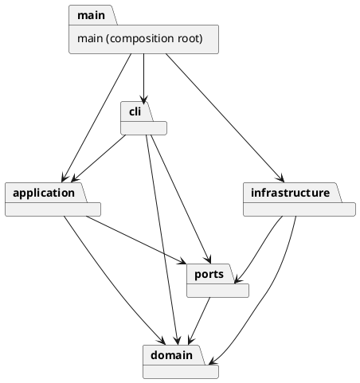

# Lab1 Phase 1：SVG 编辑器（CLI）

## 架构方案

### 1. 模块划分与职责

| 目录 | 职责 | 主要类 / 接口 |
| --- | --- | --- |
| `src/domain/` | 图形几何、样式白名单、组合树、唯一 ID、分组与层序等领域不变量 | `Shape`、五种叶子图形、`Group`、`SvgDocument`、`ShapeFactory`、`PresentationInheritance` |
| `src/application/` | 当前文档与路径、命令执行、撤销重做、文档操作后的历史屏障 | `EditorSession`、`CommandHistory`、`CommandRecord`、`commands/EditCommand` 及具体命令 |
| `src/ports/` | 文件和 SVG 编解码的抽象边界 | `FilePort`、`SvgPort` |
| `src/infrastructure/` | XML 解析/序列化、磁盘读写与原子保存 | `SvgCodec`、`NodeFileStore` |
| `src/cli/` | 分词、命令名称分发、树与属性展示、终端/脚本输入 | `Tokenizer`、`CommandRegistry`、`DocumentPresenter`、`CliRunner` |
| `src/main.ts` | 组合根：构造具体适配器并注入，不承载编辑逻辑 | 启动装配 |
| `test/` | 领域、历史、读写、CLI 集成与独立作业验收测试 | Node 内置测试运行器 |
| `tools/` | 对依赖方向与一类一文件作静态检查 | `ArchitectureCheck` |

下面是 PlantUML 包图；可编辑源文件见 [architecture.puml](architecture.puml)。箭头表示允许的源码依赖方向。



### 2. 设计模式的选择与落地

**Command（必选）**：每条编辑命令对应一个 `EditCommand` 子类，例如 `MoveCommand`、`GroupCommand`、`DeleteCommand`。命令对象封装参数、执行行为与撤销反馈，接收者是 `SvgDocument`。`CommandRegistry` 负责创建命令，`EditorSession` 经 `CommandHistory` 执行。一次 `group` 即使涉及多个原父容器，也只创建一条历史记录。

**Composite**：`Rect`、`Circle`、`Ellipse`、`Line`、`Text` 和 `Group` 共享 `Shape` 接口。容器提供子节点，叶子返回空集合。`move`、`scale` 统一遍历子树的几何属性；展示、序列化与快照也使用多态和子树遍历，不按标签重复分派。`set g fill red` 保存容器属性，使用 SVG 的样式继承语义；有显式填充色的子图形保留自己的颜色。

**Memento（配合 Command）**：`CommandRecord` 封装执行前后文档的深快照。编辑先作用于克隆，全部成功后才替换当前文档并写入历史。失败既不改变文档，也不清空 redo 分支。撤销返回前快照，重做返回后快照，避免浮点逆运算误差以及分组恢复父节点/位置遗漏。快照时间与空间开销随文档大小和历史长度增长，本阶段以正确性与可解释性优先，未引入差量补丁或历史压缩。

**工厂与依赖倒置**：`ShapeFactory` 维护内置类型到提供者的映射，CLI 创建与 SVG 读回共享它。`EditorSession` 只依赖 `FilePort` / `SvgPort`，由组合根注入磁盘与 XML 实现；测试可用内存文件适配器，无须访问真实文件。

本阶段只保留两处“按名称选择行为”的位置：

1. `CommandRegistry`：命令名 → handler / Command。
2. `ShapeFactory`：图形类型名 → create / fromSvg 提供者。

**待重构项**：目前这两张注册表仍集中列出内置实现。后续插件阶段可把注册契约抽为稳定接口，并将内置注册从构造器移至启动装配；本阶段不声称已实现完整插件系统。XML 中校验根标签/命名空间、属性白名单等属于输入验证，不是另一套图形行为分发。

### 3. 依赖方向规则

| 模块 | 允许依赖 | 原因 |
| --- | --- | --- |
| domain | domain 内部 | 领域规则不依赖终端、文件系统、XML 或应用会话 |
| ports | ports、domain | SVG 接口使用领域文档类型；不引用具体实现 |
| application | application、domain、ports | 编排用例，通过抽象访问外部资源 |
| infrastructure | infrastructure、domain、ports、Node 标准库、fast-xml-parser | 外部格式和磁盘细节集中在适配器 |
| cli | cli、application、domain、ports；仅终端相关 Node 模块 | 输入输出在外边界；文件与 XML 仍通过端口访问 |
| main | 上述模块 | 组合根是唯一装配具体实现的位置 |

CLI 允许的 Node 导入为 `node:readline`、`node:readline/promises`、`node:process`、`node:stream`，当前只使用 readline。禁止 CLI 直接导入 `node:fs` 或 XML 库，禁止 application/domain 依赖 infrastructure。模块内部可相互依赖，但不应引入循环；当前运行时 import 链不存在循环，类型依赖与启动装配分开。

违反这些规则的依赖应作为待处理项，不默默放宽方案。`npm run check` 使用 TypeScript AST 检查普通 import、export-from、require 和动态 import，兼顾类型导入；同时检查生产代码一类一文件（类名等于文件名）及无顶层自由函数。它不能证明所有设计质量，仍需审查行为与抽象职责。

### 4. 变化点假设

| 可能的变化 | 当前保留的边界 / 不提前实现的理由 |
| --- | --- |
| 新增图形和后续 `box` 复合插件 | 共同 Shape 多态协议与工厂注册点已保留；不提前实现 box，避免越过本阶段边界 |
| GUI、agent 或其他输入通道 | Command 和 EditorSession 不引用 readline，可复用用例；CLI 仅是适配器 |
| SVG 格式范围扩大 | 编解码集中在 SvgPort 实现；领域无需认识 XML 节点。未来可扩展 path、tspan、CSS 和变换矩阵 |
| 保存到云端或异步资源 | FilePort 隔离存储。目前同步本地 CLI 足够；异步端口是未来修订，未假装同步接口能直接替代云端 |
| 大文档和长历史 | 快照封装在 CommandRecord；后续可换成差量记录。当前没有性能目标，因此不加入持久化树或压缩系统 |
| 新展示格式 | DocumentPresenter 与图形 summary 分离终端缩进和图形摘要；未来新增 JSON/GUI presenter |

### 5. 明确的行为决策与阶段范围

- 内置六种类型；`create box` 或其他类型输出题目规定的 `unknown shape type` 错误。没有用普通 g 冒充 box 插件。
- ID 大小写敏感，容器与所有后代共享唯一性；导入时先收集全部显式 ID，再分配 `rect1` 等自动 ID，避免与后面才出现的元素碰撞。外部 SVG 根若已有 ID，也会保留并预留。
- `group` 保持文档遍历顺序，忽略参数列举顺序；跨父级时，新组放在文档前序中最早选中节点的原位置和父容器中。选中的容器与其后代不能同时入组。
- `front` 对应 SVG 后绘制的位置（同级数组尾部），`back` 放到数组头部；不会跨父容器。
- `ungroup` 按题目拒绝 SVG 的直接子容器；嵌套容器的子节点提升并占据原位置。会保留字面/绝对值的可继承样式并组合 transform；对导入文件中无法安全分摊的整组 opacity/filter/clip/mask 等效果，明确报错并保持状态。完整 CSS 计算样式（例如 em 字体相对单位、var/calc）不在本阶段保障范围。
- 几何操作按题目对存储的**局部几何坐标**运算：move 修改位置，scale 同乘位置与尺寸，文字内容、字体大小、stroke-width 不属于本阶段几何缩放集合。导入的 translate/scale 原样保留，因此经过外部 scale 后的屏幕位移可能不同于局部 dx/dy；没有实现世界坐标变换编辑器。
- `group` / `addto` 保持局部几何值。改变父容器可能改变继承样式或 transform 的视觉效果；没有额外引入坐标自动补偿。
- `init` 可指定 0～2 个尺寸（缺省 800/600）；`canvas` 无参数查询，两个参数修改。尺寸与半径非负，scale 必须正数，所有数值拒绝 NaN/Infinity、无效数字和计算溢出。
- 成功 `init/read/save/canvas 修改尺寸` 清空历史并设置屏障；undo 与 redo 均输出 `undo not allowed after io command`，下一次成功编辑解除。失败命令不改变屏障；`tree/show/help/canvas 查询` 不影响历史。
- `save 文件` 成功后记住该路径，之后无参数 save 可继续保存；`read` 同样记住路径，`init` 清空路径。写入失败不会更改记忆路径或历史。
- 文件使用同目录临时文件完成写入后原子替换；失败清理临时文件，现有只读文件会拒绝覆盖。
- REPL 显示 `svg>`；重定向 stdin 或 `--script` 回放时省略提示符。脚本模式即使有错误也继续执行后续行，最终返回非零状态。双引号保留空文字/空格/中文；支持引号与反斜杠转义；只有整行以 # 开头才是注释。

**SVG 导入范围**：支持六种图形及嵌套 g、普通文字/CDATA、XML 注释、默认/前缀 SVG 命名空间、数值或 px 画布尺寸、viewBox、常见呈现和 data 属性。缺省几何值按 SVG 的零值处理；缺画布尺寸时优先采用 viewBox，再用 800×600。保留 translate/scale；不支持 rotate/skew/matrix、path、tspan、defs/use、外部 CSS、百分比尺寸或非 SVG 命名空间，遇到不支持的结构会拒绝整个导入，避免静默丢图。

DTD、实体声明、事件处理属性和主动/外部 URL 等输入会被拒绝。普通 XML 字符和引用会验证并转义；这只是本阶段编辑器的格式边界，不是通用 SVG 清洗服务。XML 解析库为 [fast-xml-parser](https://github.com/NaturalIntelligence/fast-xml-parser)，版本与依赖完整性固定在 lockfile 中。

## 过程记录

以下记录来自这次 AI 协作实现和交叉审查，不虚构额外的人工作业讨论。用户提供题目并要求完成实现，另授权创建 GitHub 仓库；主智能体负责架构、集成、文档和验收，子智能体分别负责领域、命令历史及 SVG 适配器，并互相审查。

| 迭代 | 发现的问题 / 选择 | 确认方式与修正 |
| --- | --- | --- |
| 初始方案 | 将全部功能放进一个编辑器类会混合领域、XML 和终端职责 | 先划分五层，提交工具链和初稿；通过 FilePort/SvgPort 隔离 I/O |
| 图形模型 | 若每个命令 switch(tag)，新增类型需要改多处 | 统一 Shape 几何 schema 与多态方法；只在 ShapeFactory 注册，容器递归操作 |
| 历史设计 | 逆向移动会累积浮点误差；分组撤销容易忘记原父节点和层序 | 用执行前后深快照；针对跨父级 grouping、删除完整子树、失败命令的 redo 保留编写测试 |
| 导入 ID | 边读边分配 rect1 可能撞上后续显式 rect1；SVG 根 ID 也可能被后续 create 复用 | 两遍收集/分配；预留根 ID；补回归测试，警告仅在完整读取成功后发布 |
| I/O 原子性 | 若先替换当前文档或清空历史，再发现解析/保存失败，会破坏状态 | 先 read/decode 或 encode/write 全部完成，再更新会话；测试读写失败后的文档、路径、历史 |
| 解组审查 | 直接摘掉 g 会丢失继承 fill 和 transform | 补充 PresentationInheritance，保留可继承属性、子节点显式样式优先，拼接变换；无法安全扁平化的组效果原子拒绝 |
| 数值与格式审查 | 容器内部分图形移动后才溢出可能只改一半；transform 曾允许 px 或非法逗号 | 子树所有结果先验证再写入；变换采用严格的无单位 translate/scale 数字语法 |
| 终端集成 | 直接使用 tsx 可执行文件在受限环境中创建通信管道失败 | 改为 `node --import tsx src/main.ts`；用真实子进程回放 stdin、脚本、中文和带空格路径 |
| 文件与安全审查 | 原子 rename 可能绕过现有文件只读权限；导入属性可能保留事件处理器 | 写前检查可写性；拒绝活动属性/URL；补只读、临时文件清理与导出验证测试 |
| 最终验收 | 只验证模块不足以说明作业整体可用 | 独立子进程验收题目流程图、全部编辑类、错误案例、历史屏障；另做 AST 架构检查与演示 SVG 读回 |

**架构修订记录**：初稿的五个模块维持不变；实施时将会话编排明确放入 application，增加 SvgPort 使其不引用具体 XML 类；补充 PresentationInheritance 属于 domain 的解组规则；明确 CLI 的终端 Node 依赖例外与组合根职责。没有增加插件框架或 GUI。

## 一致性自查

1. **模块划分是否一致？** 一致。实际生产目录正是 domain/application/ports/infrastructure/cli，加 main 装配入口。test/tools/doc/examples 属于测试、检查和交付材料。上述职责澄清和新增辅助类已列入修订记录。
2. **依赖方向是否违反？** 当前无违反。抽查 `Shape.ts` 不导入外部模块；`CommandHistory.ts` 只导入 domain 与自身命令记录；`EditorSession.ts` 只导入 domain、ports 与同模块历史；`SvgCodec.ts` 仅引用 domain 和 XML 库；`CliRunner.ts` 使用 FilePort 与 readline；只有 main 将具体适配器注入会话。AST 检查对当前全部生产文件执行，验证结果见 [verification.txt](verification.txt)。

源码类采用 private/protected 封装字段。对外 attributes/children 返回只读拷贝，历史快照也不暴露可变内部引用；生产代码一类一文件、文件名与类名一致。领域的组合约束和应用层快照事务分别保证树不变量与命令级原子性。

## 质量保证手段

在工程根目录执行：

```sh
npm ci
npm run check
npm run demo
```

`npm run check` 先以严格 TypeScript 配置编译（含 noUncheckedIndexedAccess、noImplicitOverride），再运行全部测试，最后检查架构边界。测试不是仅匹配成功文案，还断言树层级、几何值、绘制顺序、SVG 读写结果、当前路径和历史分支。

| 测试文件 | 核心覆盖 |
| --- | --- |
| `test/domain.test.ts` | 六种类型，全部几何 move/scale，属性白名单，浮点/溢出，唯一 ID，循环检测，跨父分组，嵌套解组，层序，深快照 |
| `test/history.test.ts` | 每条编辑单元，失败原子性，撤销/重做分支，I/O 屏障，分组/删除恢复父级与位置 |
| `test/svg.test.ts` | 六类嵌套 round-trip，中文/引号/实体转义，自动 ID，命名空间，无效 XML、未知元素、DTD、事件/URL，原子保存/只读与清理 |
| `test/cli.test.ts` | 分词、提示/显示、完整会话、无文档错误、全部命令、路径/历史失败保持、真实 stdin/script 子进程 |
| `test/requirements.test.ts` | 独立回放题目流程图与错误案例，检查实际生成 SVG、状态与退出码，避免只依赖内部单元测试 |

本次完整检查的真实输出保存到 [verification.txt](verification.txt)，演示输出保存为 [expected-flowchart.svg](../examples/expected-flowchart.svg)。GitHub Actions 配置会在 push / pull_request 时以 Node 22 执行相同检查和演示；配置存在不代表远端运行已经通过，远端状态须以 Actions 实际结果为准。

提交记录按工具链/方案、领域模型、命令历史、SVG 适配器、CLI 与验收文档分阶段保留；最终完成时使用 `final` tag 标识提交。题目未提供具体截止时间，因此没有编造“已在截止前提交”的结论，应由提交时间与课程截止时间比较。
